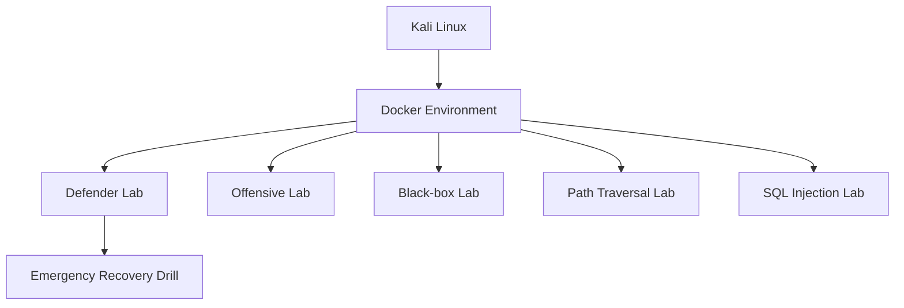

*Identify. Exploit. Defend. Recover.*

---

## 01 / Project Overview

A containerized cybersecurity home lab developed to simulate offensive and defensive security operations within an isolated, authorised environment.

Initially developed to prepare for the iHack CTF 2026 Attack & Defense Final Round, this project was subsequently expanded into a personal cybersecurity portfolio project.

## 02 / Project Objectives

- Identify and analyse web application vulnerabilities.
- Practise offensive and defensive security techniques.
- Implement secure authentication and access controls.
- Monitor application logs and service availability.
- Perform vulnerability remediation.
- Simulate incident response and emergency service recovery.

## 03 / Lab Architecture

The architecture represents the logical organisation of the home lab.

## 04 / Technologies & Tools

| Technology | Purpose |
| --- | --- |
| Kali Linux | Security testing environment |
| Python | Application development and scripting |
| Flask | Web application services |
| Docker | Containerisation |
| Docker Compose | Service orchestration |
| SQLite | Database management |
| curl | HTTP request testing |
| Netcat | Network communication |
| ss | Network socket monitoring |
| Git & GitHub | Version control |

## 05 / Offensive Security

### Broken Access Control (IDOR)

- Simulated a vulnerable user profile service.
- Tested cross-user access through manipulated request parameters.
- Identified insufficient server-side authorisation.

### SQL Injection (SQLi)

- Explored insecure database query handling.
- Implemented parameterized SQL queries.
- Tested the reported vulnerability remediation.

### Path Traversal

- Created a practice environment for unsafe file-path handling.
- Explored file access restrictions and directory validation.

### Black-box Testing

- Practised service assessment through HTTP requests and observable responses.

## 06 / Defensive Security

- Implemented Bearer token authentication.
- Stored authentication credentials using environment variables.
- Enforced per-user authorisation.
- Used constant-time token comparison.
- Monitored rejected access attempts.
- Inspected container and application logs.
- Performed service health checks.

## 07 / Incident Response & Recovery

An emergency recovery drill was conducted to simulate an unexpected application failure.

### Recovery Process

1. Identified an abnormal container restart loop.
2. Investigated application logs.
3. Created a backup of the affected application.
4. Identified and corrected a Python syntax error.
5. Validated the application syntax.
6. Rebuilt and restarted the Docker container.
7. Verified service availability through HTTP health checks.

The service was successfully restored and returned HTTP 200 OK.

## 08 / Testing Results

| Security Test | Result |
| --- | --- |
| Docker Environment Setup | Successful |
| Unauthenticated Access | HTTP 401 |
| Unauthorised Admin Access | HTTP 403 |
| IDOR Vulnerability Simulation | Successful |
| SQL Injection Remediation | Tested |
| Application Log Monitoring | Completed |
| Emergency Service Recovery | HTTP 200 OK |
| Path Traversal | Further validation required |
| Black-box Testing | Further documentation required |

## 09 / Technical Skills Developed

- Offensive Security
- Defensive Security
- Web Application Security
- Vulnerability Assessment
- Secure Coding
- Incident Response
- Security Monitoring
- Linux System Administration
- Docker Container Management
- Network Troubleshooting
- Technical Documentation
- Version Control

## 10 / Future Improvements

- [ ] Automated security regression testing
- [ ] Centralised logging with ELK Stack
- [ ] Real-time service availability monitoring
- [ ] Security alerting
- [ ] Additional vulnerability simulations
- [ ] Automated incident recovery
- [ ] Improved network architecture documentation

## 11 / Related Experience

- [iHack CTF 2026](https://github.com/rosinss/ctf-writeups/tree/main/ihack-2026)
- [Attack & Defense Final Round Experience](https://github.com/rosinss/ctf-writeups/tree/main/ihack-2026/attack-defense)
- [Certifications & Achievements](https://github.com/rosinss/certifications-and-achievements)

## 12 / Disclaimer

This project was developed exclusively for educational purposes and cybersecurity training. All security testing was conducted within isolated, owned or authorised environments.

---

*Explore. Learn. Secure. Repeat.*

[GitHub Profile](https://github.com/rosinss)

